

  

<h1 align="center">QuakeLogic MASW Studio</h1>

<strong>Standalone, offline MASW analysis: from multichannel field records to shear-wave velocity profiles, Vs30, 2D sections and reports.</strong> 
No account. No internet connection. Everything runs on your own computer.

  <a href="https://github.com/omerozgul11/masw-studio/releases/download/v1.3.3/MASW-Studio-Setup-1.3.3.exe"><strong>⬇ Download for Windows (installer, v1.3.3)</strong></a> ·
  <a href="https://github.com/omerozgul11/masw-studio/releases/download/v1.3.3/MASW-Studio-1.3.3-Client-Package.zip"><strong>⬇ everything in one zip (installer + all documents)</strong></a> ·
  <a href="https://github.com/omerozgul11/masw-studio/releases/download/v1.3.3/MASW-Studio-Brochure-and-User-Guide.pdf">brochure &amp; user guide (PDF)</a> ·
  <a href="https://github.com/omerozgul11/masw-studio/releases/download/v1.3.3/MASW-Studio-Training-1.3.2.mp4"><strong>training video (6½ min)</strong></a> ·
  <a href="marketing/QuakeLogic-MASW-Studio-Datasheet.pdf"><strong>product datasheet (PDF)</strong></a> ·
  <a href="marketing/QuakeLogic-MASW-Studio-Field-Guide.pdf"><strong>field guide: set up your equipment (PDF)</strong></a> ·
  <a href="https://github.com/omerozgul11/masw-studio/releases">release notes &amp; checksums</a> ·
  <a href="#licensing">full version · contact sales to buy</a>

---

## What it is

QuakeLogic MASW Studio is a Windows desktop application for **Multichannel Analysis of Surface
Waves (MASW)**. It takes you from the shot records of an active-source survey (SEG-2, SEG-Y, DRM (.drm) or text) to a defensible,
fully documented result:
- import and geometry review, then transparent, non-destructive preprocessing
- F–V and F–K dispersion images, with picking of named modes
- Rayleigh and Love forward modelling and bounded inversion to a layered Vs profile and Vs30
- a **2D Vs section of the whole line with a void finder**, plus refraction QC
- a professional PDF report you can preview before saving

A Library keeps every past analysis ready to reopen or combine.

It is built for geotechnical and geophysical engineers who need results they can explain. Raw
records are never modified, every processing step and parameter is recorded, interpretation depth
must be declared before Vs30 is reported, and the software never presents a non-unique layered
model or a pseudo-2D section as more than it is.

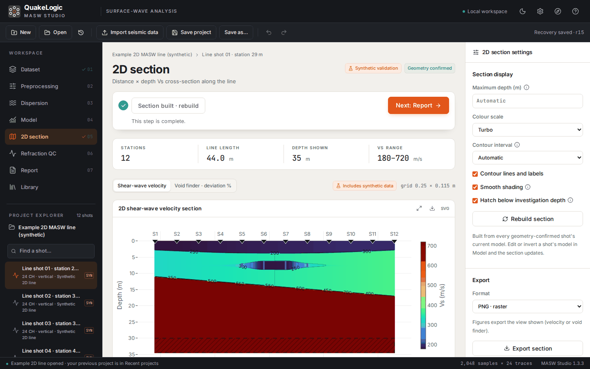

## Highlights

| | |
|---|---|
| **Truly standalone** | One installer, one icon, its own application window, bundled runtime. No services, no ports, no cloud. Works on a laptop in the field. |
| **Field data in seconds** | SEG-2 (`.sg2`, `.seg2`, `.dat`, including 20-bit), SEG-Y (`.sgy`, `.segy`), `.drm` and time-column text (`.csv`, `.txt`, `.dat`), a whole line at once. The format is recognised from the file contents. Geometry is read from the headers and confirmed before analysis. |
| **Transparent processing** | Detrend, zero-phase Butterworth filters and time/linear mutes, previewed beside the original record. Trace editing, stacking and splitting are reversible and audited. |
| **Dispersion you can trust** | Phase-shift F–V and F–K transforms with aperture and spatial-aliasing QC guides. Click-to-pick named modes with explicit uncertainty. |
| **Modelling and inversion** | Rayleigh (P–SV) and Love (SH) modes of a layered elastic earth. Bounded least-squares inversion with convergence history. A Vs30 average line over 0–30 m. |
| **2D section and void finder** | Every station of a roll-along line, interpolated on a fine grid without overshoot. The void-finder view shows slower ground in red, investigation depth is hatched, and velocity inversions are flagged. |
| **Uneven ground** | Slopes, riverbeds and valleys: geophone and source elevations are read from the file, typed, pasted or set as a straight slope. Distances are measured along the ground, and the 2D section has an elevation view that follows the real ground surface. |
| **Reports and exports** | A branded technical PDF with a page-by-page preview. PNG/SVG/PDF figures and CSV tables. |
| **Library of past analyses** | Search every project by client, site or notes, reopen it where you left off, or pull its shots into a new project. |
| **Learn it in ten minutes** | A guided tour with a bundled example SEG-2 file, an illustrated user guide built in, and an **i** circle that explains each setting in plain words. |
| **Your data stays yours** | Fully offline, no telemetry, local recovery and undo/redo, and self-contained `.qlmasw` projects. |

## Training video

A narrated walkthrough (6½ minutes) of the real application: getting started, importing
field data, preprocessing, dispersion and picking, inversion and Vs30, the report, the 2D section
with the void finder, the Library and the built-in help. Captions are burned in, and an `.srt`
subtitle file is [included in the release](https://github.com/omerozgul11/masw-studio/releases/latest).

<a href="https://github.com/omerozgul11/masw-studio/releases/download/v1.3.3/MASW-Studio-Training-1.3.2.mp4">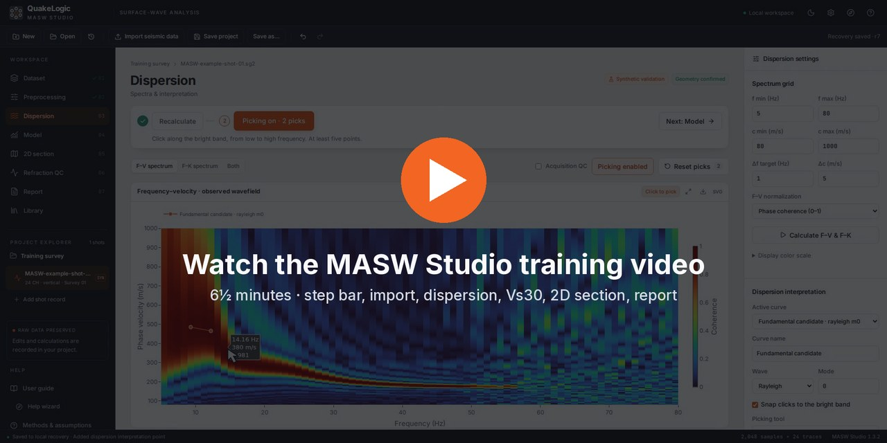</a>

| Time | Chapter |
|---|---|
| 00:00 | Introduction |
| 00:17 | Getting started |
| 00:53 | Importing field data |
| 02:22 | Preprocessing |
| 02:47 | Dispersion and picking |
| 03:34 | Velocity model and Vs30 |
| 04:13 | Report |
| 04:51 | 2D section and void finder |
| 05:30 | Library and projects |
| 05:58 | Help and support |

## Product datasheet

An 8-page datasheet for engineers, procurement and project managers covers the
workflow, standard features, supported field data, system requirements, licensing
options and full technical specifications. Download it to print or share:
**[QuakeLogic MASW Studio datasheet (PDF)](marketing/QuakeLogic-MASW-Studio-Datasheet.pdf)**.

<a href="marketing/QuakeLogic-MASW-Studio-Datasheet.pdf">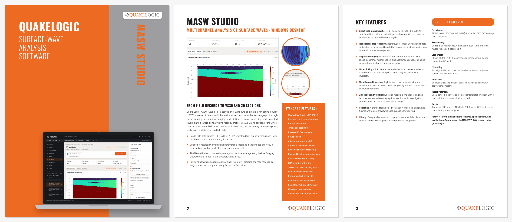</a>

<a href="marketing/QuakeLogic-MASW-Studio-Datasheet.pdf">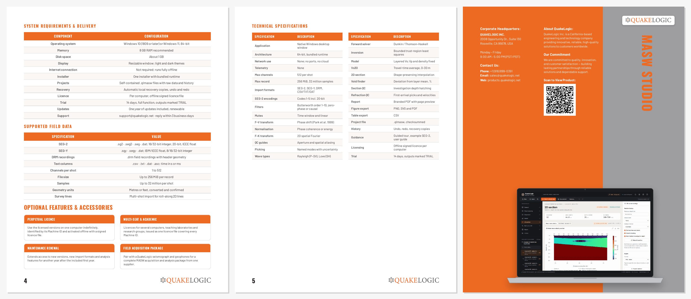</a>

## Field guide: setting up your equipment

New to MASW? The 11-page field guide follows the setup shown in our
[seismograph setup video](https://www.youtube.com/watch?v=UKbyq0FmyzE), from the equipment case to a
finished Vs report: what is in the case, how long a line to lay out for
the depth you need, unrolling the digital line cable and planting the geophones,
connecting the master unit and laptop, the recording software, recording good
shots, sloping ground, installing MASW
Studio and analysing your first file. It ends with printable checklists, a field
sheet and a troubleshooting table:
**[MASW Studio field guide (PDF)](marketing/QuakeLogic-MASW-Studio-Field-Guide.pdf)**.

## A tour of the application

### 1. Start and the guided tour
The first launch opens a step-by-step tour. It highlights each control, explains it in plain
language and moves on as you work, using a bundled example SEG-2 recording.

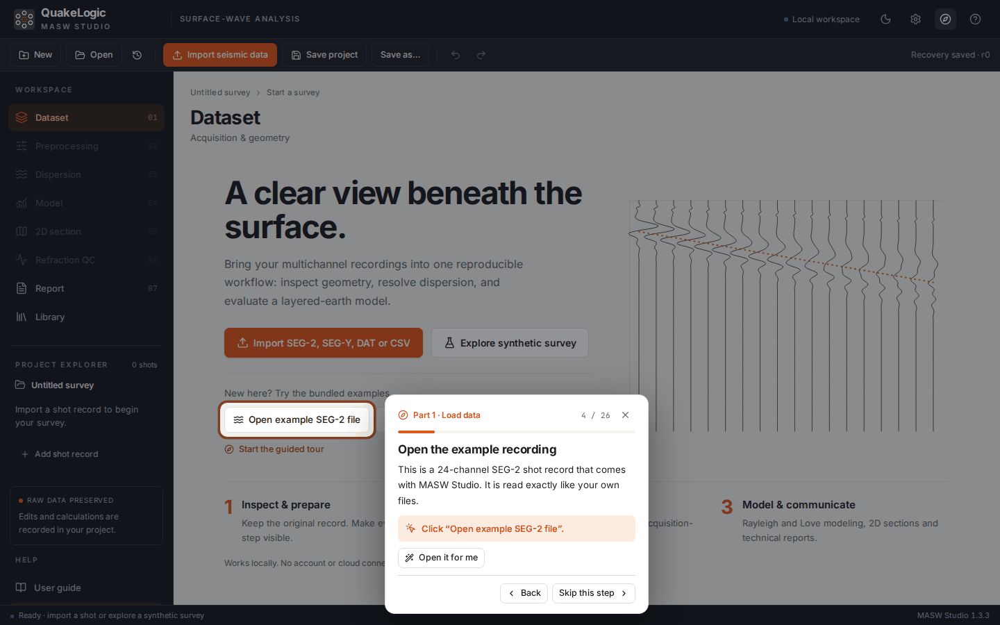

### 2. Import and geometry
Open SEG-2, SEG-Y, DAT, DRM (.drm) or CSV shot records. The import summary shows channels, sampling and the source and
receiver positions read from the file, and the geometry is confirmed before any analysis.

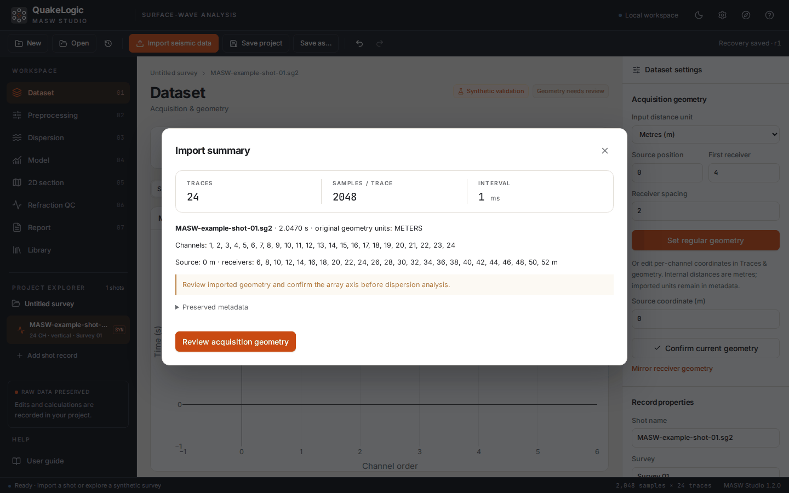

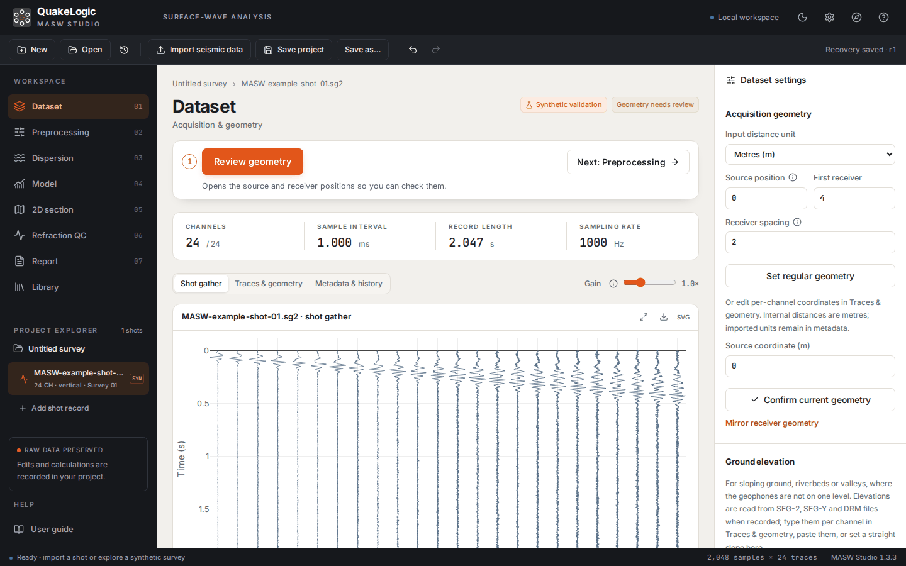

### 3. Preprocessing
Preview filters, detrending and mutes beside the original record, then apply the exact previewed
sequence. Raw data are never modified, and every step can be removed.

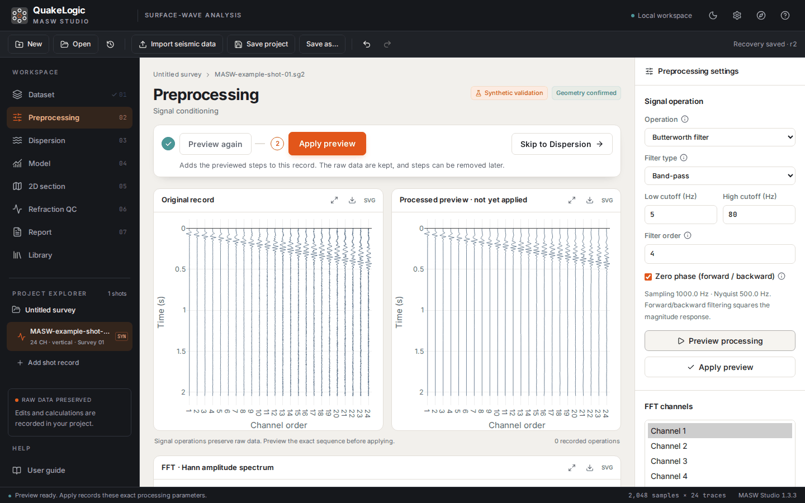

### 4. Dispersion and picking
Calculate F–V and F–K images, then trace the fundamental mode with a click. Acquisition-QC guides
show where the array can and cannot resolve.

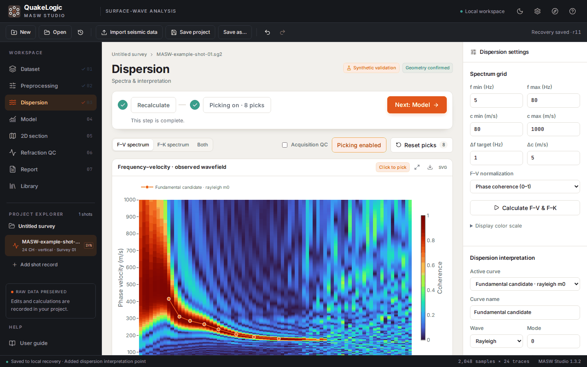

### 5. Model, inversion and Vs30
Forward-model Rayleigh or Love modes, run the bounded inversion and review the fit. The profile
shows the Vs30 average line.

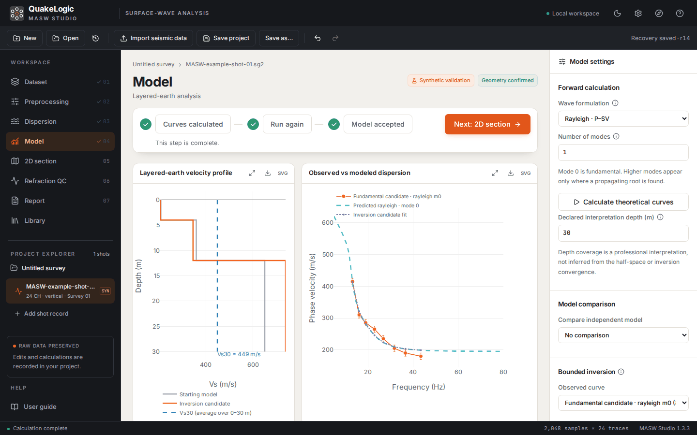

### 6. 2D Vs section and void finder
Shots along a line become a distance × depth cross-section with labelled contours. The void finder
highlights slower ground, a possible void, loose fill or soft zone, in red.

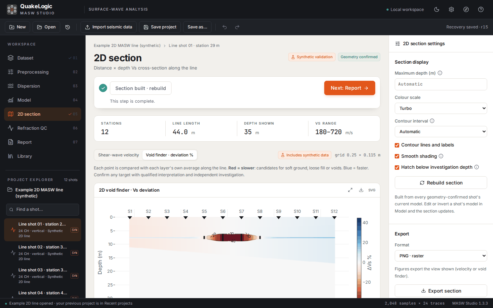

### 7. Report
Enter survey details and photos, preview the technical PDF page by page, and save it.

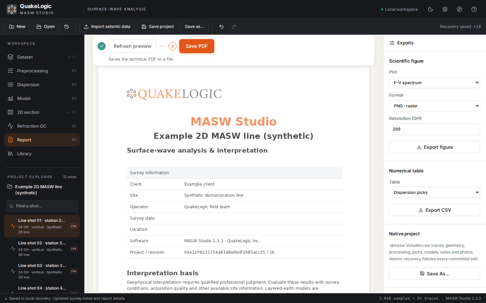

### 8. Library
Every analysis on the computer, searchable. Open one to continue, or add its shots to the current
project.

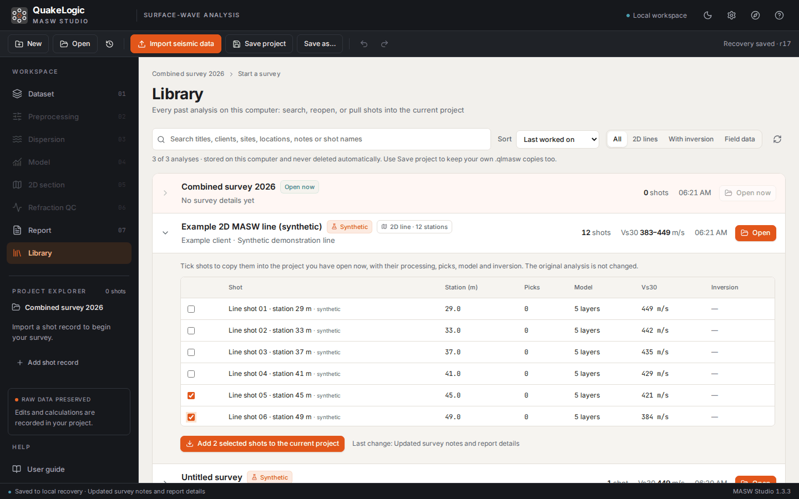

## Licensing

Every download is the **full version** of MASW Studio. There is no trial, no activation
and no licence file: every calculation, export and report works offline from the first
start. To buy MASW Studio, or for multi-computer, academic and volume pricing, contact
<sales@quakelogic.net> or +1 (916) 899-0391. Use is governed by the
[licence agreement](EULA.md).

## Download and install

**Everything in one zip:** [MASW-Studio-1.3.3-Client-Package.zip](https://github.com/omerozgul11/masw-studio/releases/download/v1.3.3/MASW-Studio-1.3.3-Client-Package.zip)
(282 MB) holds the installer, the field guide, the training video, the brochure and user guide,
the datasheet, the licence and a **START HERE** sheet with these steps. Right-click it, choose
**Extract All…**, and open **START HERE.txt**. Or download the installer on its own:

**Windows 10 (1809 or later) / 11, 64-bit.** About 1 GB of disk; 8 GB RAM recommended.

1. Download the installer: [MASW-Studio-Setup-1.3.3.exe](https://github.com/omerozgul11/masw-studio/releases/download/v1.3.3/MASW-Studio-Setup-1.3.3.exe)
   (release notes and checksums are on the [Releases](https://github.com/omerozgul11/masw-studio/releases) page).
2. Run it, accept the licence agreement and leave **Launch MASW Studio** selected. Installing
   for all users asks for administrator approval.
3. Later, start it from the Start menu, the desktop icon or by double-clicking a `.qlmasw` project.
   It opens in its own window, and closing the window stops it.

Upgrading keeps all projects, recovery copies and preferences. The installer is not yet code-signed,
so Windows may show **Unknown publisher**: choose **More info → Run anyway**.

## Supported data

| Input | Notes |
|---|---|
| SEG-2 revision 1 | `.sg2`, `.seg2`, `.seg`, `.dat`; encodings 1, 2, 3, 4, 5 (16/32-bit integer, 20-bit packed, 32/64-bit IEEE float); up to 512 channels, 256 MiB per file; geometry and units from the headers |
| SEG-Y rev 0/1/2 | `.sgy`, `.segy`, `.dat`; IBM or IEEE float, 8/16/32-bit integer; big- or little-endian; geometry from coordinates or offsets |
| DRM field recordings | native `.drm` recordings (32-bit samples, channel positions and enabled flags from the header), plus `.drm` files holding SEG-2/SEG-Y; SEG-2 exports with `UNITS NONE` keep their positions |
| Text columns | `.csv`, `.txt`, `.dat`, `.asc`; a time column (s or ms) plus one column per channel; comma, semicolon, tab or space separated; header optional |
| `.qlmasw` projects | self-contained projects with raw data, processing, picks, models, notes and photos |
| Not supported | SU, SEG-D and other proprietary formats; export SEG-2 or SEG-Y instead |

## Scientific method in one paragraph

Each enabled trace is processed exactly as recorded in the project. F–V images use the phase-shift
transform (Park, Miller &amp; Xia 1999) with phase-coherence or energy normalisation, and F–K images
use the spatial Fourier transform. Aperture and spatial-aliasing limits are drawn as QC guides.
Theoretical dispersion curves of the layered elastic model come from the open-source disba solver
(Dunkin compound matrix for Rayleigh, Thomson–Haskell for Love). Inversion is a bounded,
uncertainty-weighted trust-region least-squares fit with fixed Vp and density (Xia, Miller &amp; Park
1999). Vs30 is the travel-time average over the top 30 m, reported only within the declared
interpretation depth. The 2D section places each station's 1D model at its spread midpoint and
interpolates with a shape-preserving curve. It is a pseudo-2D presentation, not a 2D inversion.
Full details and citations are in the scientific-methods document built into the app.

## Documentation

| Document | Content |
|---|---|
| [Brochure &amp; user guide (PDF)](https://github.com/omerozgul11/masw-studio/releases/download/v1.3.3/MASW-Studio-Brochure-and-User-Guide.pdf) | product overview and the complete illustrated user guide (also in the app under *User guide*) |
| [Training video (MP4, 6½ min)](https://github.com/omerozgul11/masw-studio/releases/download/v1.3.3/MASW-Studio-Training-1.3.2.mp4) | narrated walkthrough of the complete workflow, with captions |
| [Product datasheet (PDF)](marketing/QuakeLogic-MASW-Studio-Datasheet.pdf) | 8-page overview: features, supported data, requirements, licensing options, specifications |
| [Client package (ZIP, 282 MB)](https://github.com/omerozgul11/masw-studio/releases/download/v1.3.3/MASW-Studio-1.3.3-Client-Package.zip) | everything to send a client: installer, field guide, training video, brochure and user guide, datasheet, licence and a START HERE sheet |
| [Field guide (PDF)](marketing/QuakeLogic-MASW-Studio-Field-Guide.pdf) | 11 pages following the [seismograph setup video](https://www.youtube.com/watch?v=UKbyq0FmyzE): equipment case, line layout, digital line cable and geophones, master unit and laptop, recording software, recording a shot, installing and using MASW Studio, checklists, field sheet and troubleshooting |
| In-app user guide | installation, every workspace, the 2D section, Library, licensing, shortcuts |
| In-app scientific methods and validation record | algorithms, equations, citations and test evidence |
| [Licence agreement](EULA.md) | end-user licence agreement |
| [Third-party notices](THIRD-PARTY-NOTICES.md) | open-source components and their licences; Qt/PySide sources are attached to each release (LGPL) |

## Support

QuakeLogic Inc. · 2008 Opportunity Dr., Suite 130, Roseville, CA 95678, USA ·
+1 (916) 899-0391 · <sales@quakelogic.net> · <support@quakelogic.net> (response within 3 business days) ·
<https://www.quakelogic.net> · [MASW Studio on products.quakelogic.net](https://products.quakelogic.net/product/quakelogic-masw-studio-professional-masw-analysis-software/)

## Licence

MASW Studio is proprietary software licensed under the [end-user licence agreement](EULA.md). It
includes open-source components under their own licences ([third-party notices](THIRD-PARTY-NOTICES.md)).

---
© QuakeLogic Inc. This repository distributes the MASW Studio installer and documentation only; the source code is private.
